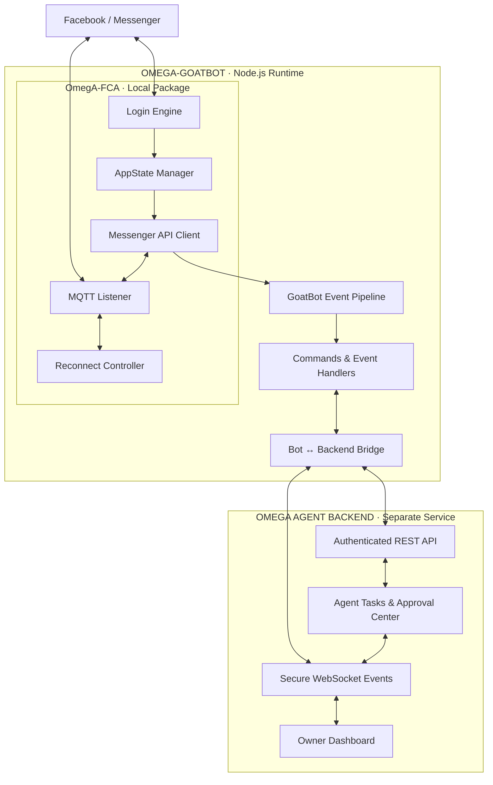
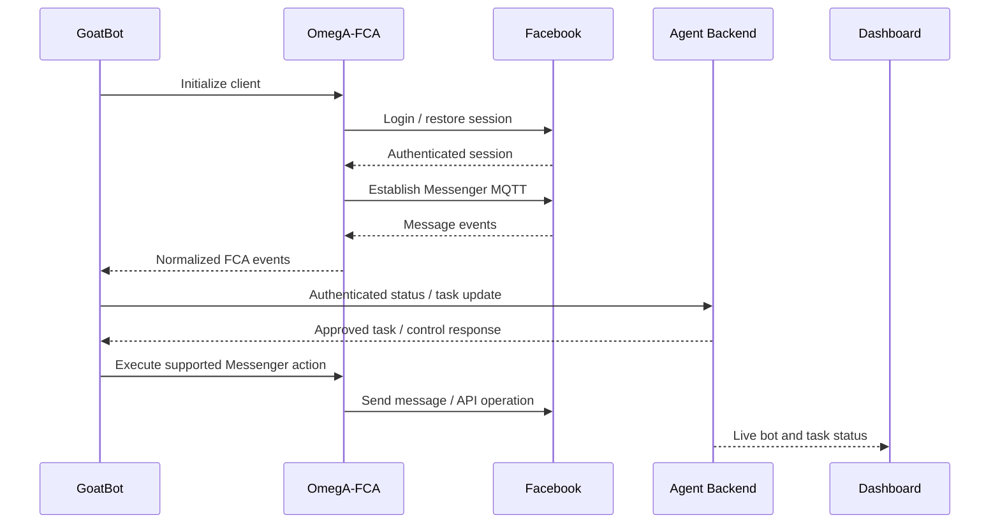

<div align="center">


### Facebook Messenger Bot Framework

**A customized Goat Bot V2 project — developed and maintained by NirZon.**


*Fast • Flexible • Customizable • Community-driven*

</div>

---

## ✦ About OmegA Bot

**OmegA Bot** is a customized Facebook Messenger bot framework built on the open-source [Goat Bot V2](https://github.com/ntkhang03/Goat-Bot-V2), originally created by **NTKhang**.

The project is developed and maintained by **NirZon**. It brings together modular commands, event listeners, configurable bot behavior, and optional backend integrations in one extensible framework.

## ⚡ Features

| Feature | Description |
|---|---|
| ⚙️ Modular commands | Supports command handlers such as onStart, onReply, onReaction, onChat, and onEvent |
| 🛡️ Admin controls | Configure bot administrators and command permissions |
| 🌐 Multi-language | Language support for several locales, including English and Bengali |
| 🎛️ Chat settings | Manage supported bot settings through chat commands |
| 💬 Event handling | Respond to group events and Messenger activity |
| 🤖 Optional Agent | Connect a separately deployed agent service when the matching integration is configured |

> **Development status:** The Facebook connection layer is undergoing private FCA integration work. Its implementation and compatibility are not exposed as a public package link. Some legacy FCA methods may still be under migration, so verify the current branch and tests before production use.

---

## 🚀 Quick Start

### Requirements

- Node.js 20.x
- npm 7 or newer
- A Facebook session supported by the connection layer configured in your checkout
- Railway or a VPS for a persistent bot process
- MongoDB and the separate Agent Backend only if you use optional agent features

### Install

```bash
git clone https://github.com/nirzon-islam/OmegA-Goatbot.git
cd OmegA-Goatbot
npm install
```

Configure the bot using the configuration files and session method supported by your selected branch. Keep all credentials and session data private.

### Run

```bash
npm start
```

Development mode:

```bash
npm run dev
```

---

## 🔧 Configuration & Security

- Set your bot administrator UID and command prefix in the project's configuration.
- Keep Facebook session data, access tokens, API keys, database URLs, and passwords private.
- Never commit `account.txt`, session files, or production environment files.
- Use a private repository or deployment secret manager for sensitive configuration.
- If a Facebook login challenge or checkpoint appears, resolve it through the account owner's official login flow. Never attempt to bypass security checks.

## ☁️ Deployment

### Railway

1. Create a Railway project and connect this repository.
2. Select the branch you want to test.
3. Set the start command to `npm start`.
4. Add only environment variables required by the current code and enabled integrations.
5. Deploy, then inspect the service logs for startup and connection errors.

Railway normally supplies the `PORT` variable for web services. A bot process does not need extra custom variables unless the application or an enabled integration explicitly requires them.

### VPS

Install Node.js 20.x, clone the repository, run `npm install`, configure the bot, and start it with `npm start`. A process manager such as PM2 can keep the process alive.

**Hosting note:** OmegA Bot relies on a persistent Messenger connection and may write session/runtime data. Use a host that supports long-running processes and persistent storage. Verify filesystem and networking behavior before deploying.

---

<div align="center">


### 🧠 OmegA Agent Backend
**A separate control center for AI-assisted bot management**

[](https://github.com/nirzon-islam/Agent-Backend)
[](https://nodejs.org/)

</div>

OmegA Agent Backend is the separately hosted management and AI layer for OmegA Bot. It provides an owner-authenticated dashboard, AI provider configuration, task planning, approval-controlled operations, activity history, and supported recovery workflows.

**The backend is required for the optional AI Agent and remote management features.** The core Messenger bot can run independently, but Agent features will not work without the backend, database, provider configuration, and a compatible bot-side bridge.

#### What the Agent system provides

| Module | Purpose |
|---|---|
| Owner Dashboard | Protected owner access to agent settings and workflows |
| AI Providers | Main, Fallback and Backup provider slots |
| AI Task Assistant | Code analysis, task planning and supported project actions |
| Approval Center | Review and approve controlled actions before execution |
| Activity History | Track tasks and agent activity |
| Backup & Rollback | Recovery support for supported file changes |
| Account Recovery | Protected Facebook session reconnection workflow with account-ID validation and verification |
| Bot Bridge | Signed communication between the backend and a compatible OmegA Bot runtime |

#### System architecture

```text
Owner / Messenger
       │
       ▼
OmegA Agent Backend (Render)
       │
       ├── MongoDB
       ├── AI Providers
       └── Owner Dashboard
                │
         Signed Bridge
          (opt-in setup)
                │
                ▼
       OmegA Bot Runtime (Railway)
```

#### Deployment overview

1. Open the [OmegA Agent Backend repository](https://github.com/nirzon-islam/Agent-Backend).
2. Follow its [deployment guide](https://github.com/nirzon-islam/Agent-Backend/blob/main/DEPLOYMENT.md) and `.env.example`.
3. Deploy it as a Render **Web Service** with `npm install` (or `npm ci` when a lockfile is present) and `npm start`.
4. Configure MongoDB, owner login credentials and the AI settings encryption key in the host environment settings.
5. Verify `/api/health`, sign in to the owner dashboard and configure Main, Fallback and Backup AI providers.
6. Connect the backend to the exact OmegA Bot revision only after matching bridge configuration and completing end-to-end tests.

#### Important setup & security notes

- MongoDB must support replica-set transactions; MongoDB Atlas is recommended by the backend project.
- Keep the bridge disabled until both deployed revisions have passed integration tests. The backend defaults to `BRIDGE_ENABLED=false`.
- When enabling the bridge, use a strong random secret of at least 32 characters and configure the matching secret on both sides using the variable names supported by the checked-out revision.
- Keep Facebook cookies/AppState, API keys, database URLs, owner passwords and encryption keys out of Git, chat messages and logs.
- Facebook checkpoints and security challenges must be resolved by the account owner through the official flow. The Agent does not bypass them.
- A healthy backend endpoint confirms service/database health; it does not by itself prove Messenger, AI provider or bridge integration is working.

> **Compatibility notice:** The Agent Backend and OmegA Bot are separate deployments. Deploying one does not automatically connect the other. Confirm that their bridge protocol and configuration match before enabling remote actions. Account reconnection and other live Facebook workflows must be tested with an authorized account in a controlled environment.

<div align="center">

*Independent service • Owner-controlled actions • Approval-first automation*

</div>

---

## 🔷 OmegA-FCA · Connection Architecture

<div align="center">


**A dedicated connection layer between Facebook Messenger, OmegA Bot and the OmegA Agent Backend.**


</div>

OmegA-FCA is designed as a **local Node.js package inside the OmegA-Goatbot repository**. It owns the Facebook session and Messenger connection lifecycle. GoatBot consumes its client API and keeps responsibility for commands and events. The Agent Backend remains a separate management service for approvals, agent tasks, health and dashboard updates.

### 🗺️ High-level system map



### 🧩 Who does what?

| Component | Owns | Does not own |
|---|---|---|
| **OmegA-FCA** | Login/session lifecycle, AppState validation, Messenger API facade, MQTT events and reconnect lifecycle | Bot commands, AI planning or dashboard UI |
| **GoatBot Runtime** | Command loader, event handlers, message workflows and bot-side task execution | Facebook protocol internals |
| **Agent Backend** | Authenticated bot bridge, agent tasks, approvals, health records and activity history | Facebook passwords, cookies or raw AppState |
| **Owner Dashboard** | Bot status, pending approvals, task progress and management controls | Direct access to the bot's local session |

### 🔄 Connection lifecycle



1. **Initialize** — GoatBot loads its configuration and creates the OmegA-FCA client.
2. **Authenticate** — FCA restores a valid AppState or runs the configured credential-login flow.
3. **Connect** — FCA establishes the Messenger transport and starts its MQTT event listener.
4. **Dispatch** — Incoming events are normalized and forwarded to GoatBot's existing event pipeline.
5. **Coordinate** — GoatBot reports sanitized health and task updates to the backend.
6. **Approve & execute** — Approved backend tasks are validated by the bot before execution through the normal bot workflow.
7. **Recover** — FCA manages supported reconnect attempts and reports connection-state changes.

### 🔐 Session boundary · Keep credentials where they belong

<div align="center">


</div>

**Credential login — `config.json`**

The Facebook credential object belongs under `facebookAccount`. The login identifier is `fb_email` (not `fb_username`).

```json
{
  "facebookAccount": {
    "fb_email": "your-facebook-email",
    "password": "your-facebook-password",
    "twoFactorSecret": ""
  }
}
```

**Session restore — `account.txt`**

- `account.txt` is reserved for the JSON AppState cookie array only.
- It is never a username/password source.
- Existing AppState validation, atomic persistence and recovery behavior must be preserved.
- Raw cookies, passwords and 2FA secrets must never be sent to the Agent Backend, Dashboard, logs or Git history.

### 🔌 Bot ↔ Backend communication

The planned bridge uses two complementary channels:

| Channel | Intended use |
|---|---|
| **Authenticated REST API** | Bot registration/identity reference, health snapshots, task requests, approvals and task results |
| **Authenticated WebSocket** | Live connection state, task progress, approval notifications and backend events |

**Data flow**

- **GoatBot → Backend:** sanitized bot status, connection health, task progress and operational logs.
- **Backend → GoatBot:** approved agent tasks, cancellation/update signals and supported control instructions.
- **Dashboard ↔ Backend:** owner authentication, approval decisions and live status display.

The bridge must authenticate both sides, authorize every operation, validate task payloads and keep an auditable task history. Facebook credentials and AppState remain local to the bot runtime.

### 🧱 Package layout

```text
packages/
└── omega-fca/
    ├── index.js
    ├── lib/
    │   ├── credentials.js
    │   ├── appstate.js
    │   ├── login-engine.js
    │   ├── facebook-http-transport.js
    │   ├── client.js
    │   └── mqtt-listener.js
    ├── test/
    └── README.md
```

The package is intended to expose a stable client facade to GoatBot while keeping login, session, transport and event lifecycle concerns separated into focused modules.

### 🚦 Implementation status

| Area | Status |
|---|---|
| Package foundation & client facade | 🟡 In development |
| Credential parsing & AppState validation | 🟡 In development |
| Facebook HTTP login transport | 🧪 Experimental; live login not verified |
| Full Messenger protocol adapter | ⏳ Pending |
| Production MQTT handshake & event decoding | ⏳ Pending |
| GoatBot runtime integration | ⏳ Pending |
| Agent Backend bridge integration | ⏳ Pending |
| End-to-end compatibility tests | ⏳ Pending |

> **Important:** This is the target architecture and integration contract, not a claim that all components are already production-ready. The current FCA work includes a client foundation, login-engine components and a reconnectable MQTT lifecycle abstraction. Live Facebook authentication, the complete Messenger protocol adapter, production MQTT behavior, GoatBot wiring and backend end-to-end tests must be completed before production use.

<div align="center">


*Private session. Modular connection. Owner-controlled automation.*

</div>

---

## 🧩 Create Your First Command

Create a file under `scripts/cmds/`, for example `scripts/cmds/hello.js`:

```js
module.exports = {
  config: {
    name: "hello",
    version: "1.0.0",
    author: "NirZon",
    countDown: 5,
    role: 0,
    shortDescription: "Say hello",
    longDescription: "Replies with a greeting",
    category: "utility",
    guide: "{prefix}hello"
  },

  onStart: async function ({ message }) {
    message.reply("Hello from OmegA Bot!");
  }
};
```

### Permission roles

| Role | Permission |
|---|---|
| `0` | Everyone |
| `1` | Group administrators |
| `2` | Bot administrators |

The exact available APIs and event fields depend on the connection provider and compatibility layer installed in your checkout. Check the source and tests before relying on a method.

---

## 🔗 Project & Contact

- **OmegA Bot:** https://github.com/nirzon-islam/OmegA-Goatbot
- **Email:** [salmanxhowdhury@gmail.com](mailto:salmanxhowdhury@gmail.com)
- **Facebook:** https://www.facebook.com/61561645647195
- **Telegram:** https://t.me/dark_shades1
- **Original Goat Bot V2:** https://github.com/ntkhang03/Goat-Bot-V2
- **Node.js:** https://nodejs.org/
- **Railway:** https://railway.com/

## 📜 Credits & License

OmegA Bot is based on **Goat Bot V2**, originally created by **NTKhang**. The upstream project's original license and attribution are respected. OmegA Bot's custom development and maintenance are by **NirZon**.

See the repository's `LICENSE` file for the applicable license terms.

---

<div align="center">


**OmegA Bot · Developed with care by NirZon**

*Open source roots. Independent vision. OmegA identity.*

</div>
